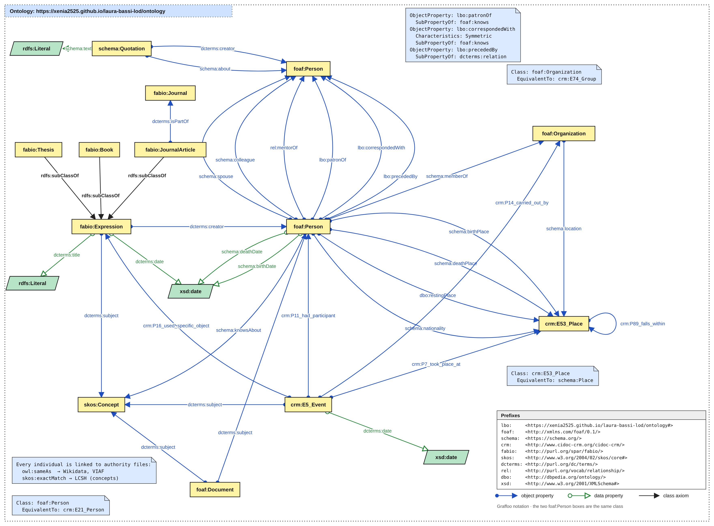

# Conceptual model

The theoretical model ([`theoretical_model.md`](theoretical_model.md)) is formalised here into an ontology.
Following the project guidelines, **every term is reused from an existing vocabulary** whenever one fits, and new terms are created only where nothing existing expresses the relation.

- Formal model (OWL/Turtle): [`ontology.ttl`](ontology.ttl)
- Graphical representation in **Graffoo** notation: [`conceptual_model_graffoo.svg`](conceptual_model_graffoo.svg) (generated by [`graffoo_diagram.py`](graffoo_diagram.py))

## Reused vocabularies and why

| Vocabulary | Used for | Reason for reuse |
|---|---|---|
| **FOAF** | `foaf:Person`, `foaf:Organization`, `foaf:Document`, `foaf:knows` | De-facto standard for people and agents on the Web of Data; also used by Wikidata/DBpedia mappings. Aligned to CIDOC CRM (`crm:E21_Person`, `crm:E74_Group`). |
| **schema.org** | spouse, colleague, birth/death place and date, nationality, membership, knowsAbout, `schema:Quotation` | Widely adopted, simple person-centred properties that FOAF lacks; `schema:Quotation` models the quotations annotated in the TEI. |
| **CIDOC CRM** | `crm:E5_Event`, `crm:E53_Place`, `P11_had_participant`, `P14_carried_out_by`, `P7_took_place_at`, `P16_used_specific_object`, `P89_falls_within` | ISO 21127 reference ontology for cultural heritage. Its event-centric model represents the career milestones of Laura Bassi (thesis defence, doctorate, appointments, marriage) with participants, places and objects. |
| **FaBiO** (SPAR) | `fabio:Expression`, `fabio:Thesis`, `fabio:Book`, `fabio:JournalArticle`, `fabio:Journal` | FRBR-based ontology for bibliographic entities: types the 49 theses (*Philosophica Studia*), the treatise *De aeris compressione*, Algarotti's book and the works cited in the bibliography. |
| **DC Terms** | `dcterms:creator`, `dcterms:subject`, `dcterms:date`, `dcterms:title`, `dcterms:isPartOf`, `dcterms:relation` | Transversal metadata vocabulary (Lecture 4), combined with the other models. |
| **SKOS** | `skos:Concept`, `skos:exactMatch` | Subjects and fields of study (Newtonianism, experimental physics, electricity…) as a small concept scheme aligned to LCSH and Wikidata. |
| **RELATIONSHIP** | `rel:mentorOf` | Teacher–student relation (Bassi → Spallanzani; Manfredi → Bassi). |
| **DBpedia Ontology** | `dbo:restingPlace` | Burial place (no equivalent in schema.org or FOAF). |
| **OWL** | `owl:sameAs`, `owl:equivalentClass` | Reconciliation of local resources with Wikidata and VIAF; class alignments between vocabularies. |

## From the theoretical model to ontology terms

| Theoretical model | Ontology term | Domain → Range |
|---|---|---|
| Person / Place / Organisation / Event | `foaf:Person` · `crm:E53_Place` · `foaf:Organization` · `crm:E5_Event` | — |
| Work (theses, treatise, book, article) | `fabio:Thesis` · `fabio:Expression` · `fabio:Book` · `fabio:JournalArticle` | — |
| Subject / field | `skos:Concept` | — |
| Quotation | `schema:Quotation` | — |
| Wikipedia page / TEI document | `foaf:Document` | — |
| born / died in | `schema:birthPlace` · `schema:deathPlace` | Person → Place |
| born / died on | `schema:birthDate` · `schema:deathDate` | Person → `xsd:date` |
| buried in | `dbo:restingPlace` | Person → Place |
| citizen of | `schema:nationality` | Person → Place |
| married | `schema:spouse` (+ marriage as `crm:E5_Event`) | Person → Person |
| colleague of | `schema:colleague` | Person → Person |
| taught / student of | `rel:mentorOf` | Person → Person |
| patronised by | **`lbo:patronOf`** ⊑ `foaf:knows` | Person → Person |
| corresponded with | **`lbo:correspondedWith`** ⊑ `foaf:knows` (symmetric) | Person → Person |
| preceded by | **`lbo:precededBy`** ⊑ `dcterms:relation` | Person → Person |
| member of | `schema:memberOf` | Person → Organization |
| worked on / populariser of | `schema:knowsAbout` | Person → Concept |
| participant in | `crm:P11_had_participant` (inverse direction) | Event → Person |
| awarded / examined by | `crm:P14_carried_out_by` | Event → Organization |
| took place at | `crm:P7_took_place_at` | Event → Place |
| presented (the theses) | `crm:P16_used_specific_object` | Event → Expression |
| date of an event / work | `dcterms:date` | Event / Expression → `xsd:date` |
| author of | `dcterms:creator` (inverse direction) | Expression / Quotation → Person |
| about / subject | `dcterms:subject` · `schema:about` | Expression, Event, Document → Concept / Person |
| published in | `dcterms:isPartOf` | JournalArticle → Journal |
| located in / part of | `schema:location` · `crm:P89_falls_within` | Organization → Place · Place → Place |
| authority control | `owl:sameAs` (Wikidata, VIAF) · `skos:exactMatch` (LCSH) | resource → external URI |

## New terms

Only three properties are new (namespace `lbo:` = `https://xenia2525.github.io/laura-bassi-lod/ontology#`). Each one is declared as a sub-property of an existing property, so the data stays interoperable:

- **`lbo:patronOf`**: none of FOAF, schema.org or RELATIONSHIP has a patronage relation, which is central to the career of Laura Bassi (Cardinal Lambertini, later Pope Benedict XIV).
- **`lbo:correspondedWith`**: `foaf:knows` is too generic, and the page explicitly mentions an exchange of letters (Voltaire, Volta, Algarotti).
- **`lbo:precededBy`**: expresses that Elena Cornaro Piscopia had obtained a university degree before her.

## URIs

- Ontology: `https://xenia2525.github.io/laura-bassi-lod/ontology#`
- Data (individuals): `https://xenia2525.github.io/laura-bassi-lod/resource/{id}`. The `{id}` values are the ones in [`../docs/entities.csv`](../docs/entities.csv).
