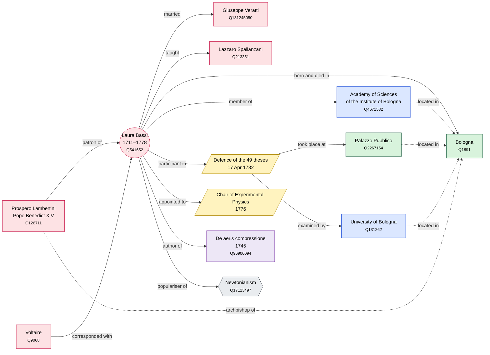

# Theoretical model

From all the entities annotated in the TEI (see [`../docs/entities.csv`](../docs/entities.csv)), **13 core entities** were selected for the models. They are the ones that best answer the project question, *how did a woman build a scientific career in eighteenth-century Bologna?*, and together they cover every kind of entity: people, places, organisations, events, a work and a concept.

The model shows how each of them relates to Laura Bassi. Dashed edges are **indirect relations**, not stated in the page but taken from Wikidata or from the other entities. Every node carries its Wikidata identifier (authority control).

## The 13 core entities

| | Entity | Type | Authority |
|---|---|---|---|
| 1 | Laura Bassi | Person (topic) | Wikidata Q541652 · VIAF 42647435 |
| 2 | Prospero Lambertini (Pope Benedict XIV) | Person | Wikidata Q126711 · VIAF 76327169 |
| 3 | Giuseppe Veratti | Person | Wikidata Q131245050 · VIAF 275491168 |
| 4 | Lazzaro Spallanzani | Person | Wikidata Q213351 · VIAF 7405452 |
| 5 | Voltaire | Person | Wikidata Q9068 · VIAF 36925746 |
| 6 | Bologna | Place | Wikidata Q1891 · VIAF 144875967 |
| 7 | Palazzo Pubblico (Palazzo d'Accursio) | Place | Wikidata Q2267154 |
| 8 | University of Bologna | Organisation | Wikidata Q131262 · VIAF 155886025 |
| 9 | Academy of Sciences of the Institute of Bologna | Organisation | Wikidata Q4671532 · VIAF 127702994 |
| 10 | Public defence of the 49 theses (17 April 1732) | Event | local URI |
| 11 | Chair of Experimental Physics (1776) | Event | local URI |
| 12 | *De aeris compressione* (1745) | Work | Wikidata Q96906094 |
| 13 | Newtonianism | Concept | Wikidata Q17123497 |

## Graph

## Relations in natural language

- **Prospero Lambertini**, Archbishop of Bologna and later **Pope Benedict XIV**, was Laura Bassi's patron.
- She married **Giuseppe Veratti**, physician and lecturer in anatomy, on 7 February 1738.
- She taught her cousin **Lazzaro Spallanzani**.
- **Voltaire** corresponded with her: *"There is no Bassi in London…"*.
- She was born (1711) and died (1778) in **Bologna**.
- She was elected to the **Academy of Sciences of the Institute of Bologna** in 1732.
- On 17 April 1732 she publicly **defended 49 theses** in the **Palazzo Pubblico**, before the professors of the **University of Bologna**.
- In 1776 she obtained the **Chair of Experimental Physics**, which she held until her death.
- She wrote the treatise ***De aeris compressione*** (1745).
- She was the most important populariser of **Newtonianism** in Italy.

Indirect relations (dashed): Lambertini was archbishop of Bologna; the Palazzo Pubblico, the university and the academy are located in Bologna.

The other entities annotated in the TEI (further people, places, events, works and the bibliography) are kept in the edition and in the RDF dataset, but they are not part of the models.
