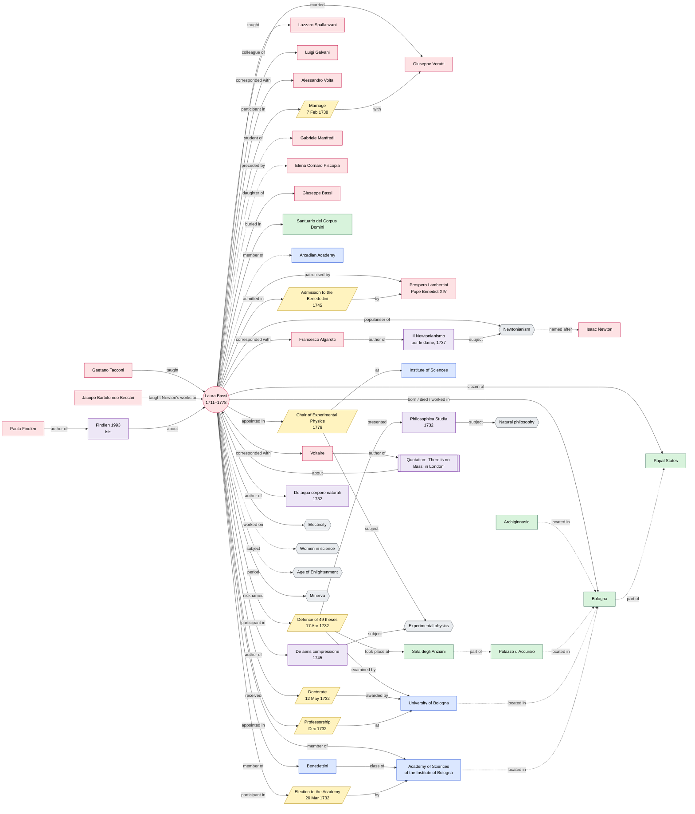

# Theoretical model

Relations between the topic of the page (**Laura Bassi**) and the selected entities, expressed in natural language and as a graph.
Dashed edges are **indirect relations**: entities or facts not stated in the Wikipedia page, taken from Wikidata or from the other entities.
Authority identifiers (Wikidata / VIAF / LC) are listed in [`../docs/entities.csv`](../docs/entities.csv).

## Graph

## Relations in natural language

**Life and places**
- Laura Bassi was born (29 Oct 1711) and died (20 Feb 1778) in **Bologna**, then part of the **Papal States**.
- She is buried in the **Santuario del Corpus Domini** (indirect: from Wikidata).

**People**
- She married **Giuseppe Veratti**, physician and lecturer in anatomy, on 7 February 1738.
- Cardinal **Prospero Lambertini**, later **Pope Benedict XIV**, was her most important patron.
- She corresponded with **Voltaire**, **Alessandro Volta** and **Francesco Algarotti**.
- She was a colleague of **Luigi Galvani** and the teacher of her cousin **Lazzaro Spallanzani**.
- She was the daughter of **Giuseppe Bassi**, a lawyer.
- She was tutored by **Gaetano Tacconi**; after her doctorate she studied Newton with **Jacopo Bartolomeo Beccari** and mathematical analysis with **Gabriele Manfredi**.
- **Elena Cornaro Piscopia** (Padua, 1678) was the first woman to earn a university degree; Bassi was the second.

**Events (career)**
- On 20 March 1732 she was elected to the **Academy of Sciences of the Institute of Bologna**.
- On 17 April 1732 she publicly defended 49 theses (*Philosophica Studia*) in the **Sala degli Anziani** of the **Palazzo d'Accursio** (Palazzo Pubblico) before the professors of the **University of Bologna**; on 27 June she defended twelve more at the **Archiginnasio**.
- She received her doctorate on 12 May 1732.
- In December 1732 she was appointed professor of natural philosophy.
- In 1745 **Benedict XIV** created a 25th place for her among the **Benedettini**.
- In 1776 she obtained the **Chair of Experimental Physics** at the **Institute of Sciences**, which she held until her death.
- She was a member of the **Academy of Sciences of the Institute of Bologna** and of the **Arcadian Academy** (indirect: from Wikidata).

**Works and ideas**
- Her first lecture was *De aqua corpore naturali…* (1732); she wrote the treatise **De aeris compressione** (1745).
- She was known as the "Bolognese **Minerva**".
- She was the most important populariser of **Newtonianism** in Italy (indirect link to **Isaac Newton**).
- Algarotti's **Il Newtonianismo per le dame** (1737) belongs to the same Newtonian context.
- Her research fields: **experimental physics**, **natural philosophy**, **electricity**.

**Textual phenomena and bibliography**
- Quotation from Voltaire: *"There is no Bassi in London…"*.
- **Paula Findlen** wrote "Science as a Career in Enlightenment Italy: The Strategies of Laura Bassi" (*Isis*, 1993), cited in the page's bibliography.

**Subjects and classification**
- Women in science · Age of Enlightenment (LCSH sh85044032) · Physics (LCSH sh85101653) · Natural philosophy (LCSH sh85101004) · Electricity (LCSH sh85042065).
